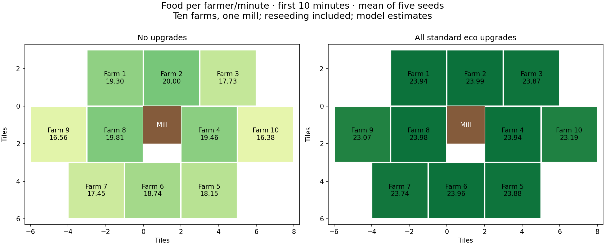

# Generic farming simulation review

**Experimental model, not a verified reproduction of current DE farmer trajectories.**

Ten passable 3×3 farms surround one solid 2×2 mill: eight in a compact pinwheel and two outside the east/west farms. Flat terrain, one farmer per farm, no civilization bonuses. Coordinates are in the fixtures. Initial mill/farm construction is excluded; reseeding is enabled in the measured runs. All times are game seconds.

## Source-backed inputs

User DAT SHA-256: `d0aefd92428e2215d6f4d9b1d544901e6f171e19183f9e0b88218de5153a337f`. The reviewed raw extract and selected numeric effect commands are exported alongside each fixture. Source date is not an executable-patch identifier.

| Parameter | No upgrades | All standard upgrades |
|---|---:|---:|
| Farmer active harvest rate | 0.53 food/s | 0.53 food/s |
| Farm available-food replenishment | 0.40 food/s | 0.40 food/s |
| Available-food pool capacity | 15 | 15 |
| Farmer carry capacity (rounded model) | 10 | 21 |
| Movement speed | 0.800 tiles/s | 0.968 tiles/s |
| Farm food budget | 175 | 550 |
| Farm wood / single-builder time | 60 wood / 15s | 60 wood / 15s |

Full profile: Horse Collar, Heavy Plow, Crop Rotation, Wheelbarrow and Hand Cart. Heavy Plow adds one carrying capacity; the mill upgrades otherwise increase farm lifetime. Treadmill Crane is outside this standard economic profile. The source mill costs 100 wood. Ten starting farms plus mill therefore represent 700 wood, excluded from recurring income.

## Rates

Means across five seeds. Harvested food includes banked food plus the change in carried inventory; carried food is not yet spendable.

| Profile | First minute, harvested | Minutes 2–7, harvested | First 10 min, harvested | First 10 min, banked |
|---|---:|---:|---:|---:|
| No upgrades | 19.73 | 18.79 | 18.36 | 17.97 |
| Wheelbarrow | 21.85 | 21.58 | 20.71 | 20.10 |
| Wheelbarrow + Heavy Plow | 22.02 | 22.04 | 21.93 | 21.28 |
| All standard eco upgrades | 22.10 | 24.13 | 23.76 | 22.97 |

A window can temporarily exceed 24 food/minute by drawing down food accumulated in the farm pool before that window. The zero-pool simulation from time zero respects the total production bound. Its first minute also contains initial travel and incomplete delivery cycles.

## Travel and working time

Mean seconds per farmer in the first 600 seconds (five seeds).

| Profile | Working | Internal walking | Walk to mill | Walk back | Blocked | Rebuilding |
|---|---:|---:|---:|---:|---:|---:|
| No upgrades | 346.9 | 112.3 | 60.0 | 63.8 | 4.8 | 10.9 |
| All standard eco upgrades | 478.7 | 56.6 | 30.3 | 32.1 | 1.3 | 0.0 |

Initial travel and any idle time account for the remaining seconds. Standing time is computed from the food harvested at each spot and pool availability; it is not a fixed animation timer. Nominal four-stop model: a base quarter-load takes 4.72s at full harvest rate or 6.25s with an empty pool; a 21-capacity quarter-load takes 9.91–13.13s. Walking time follows actual route length and speed. Deposits occur at mill contact; any deposit-animation delay remains unverified.

| Farm | Placement | No upgrades: food/min | Full: food/min | No upgrades: deposit round trips (s) | Full: deposit round trips (s) |
|---|---|---:|---:|---:|---:|
| 1 | inner | 19.30 | 23.94 | 101.1 | 49.3 |
| 2 | inner | 20.00 | 23.99 | 78.8 | 35.9 |
| 3 | inner | 17.73 | 23.87 | 137.9 | 69.3 |
| 4 | inner | 19.46 | 23.94 | 77.8 | 34.9 |
| 5 | inner | 18.15 | 23.88 | 133.1 | 66.8 |
| 6 | inner | 18.74 | 23.96 | 117.6 | 53.9 |
| 7 | inner | 17.45 | 23.74 | 159.1 | 81.6 |
| 8 | inner | 19.81 | 23.98 | 80.7 | 35.7 |
| 9 | outer | 16.56 | 23.07 | 177.1 | 98.8 |
| 10 | outer | 16.38 | 23.19 | 174.4 | 97.0 |

## Sustained runs and sensitivity

| Profile | First 30 min: harvested food/min | First 30 min: banked food/min | Reseed wood, all ten farms |
|---|---:|---:|---:|
| No upgrades | 18.27 | 18.17 | 1680 |
| All standard eco upgrades | 23.53 | 23.09 | 600 |

Reseed wood is reported separately, not subtracted from food or converted to labor. Rebuilding assumes a funded external wood budget, final partial-load deposit, return to the previous work spot, and the source single-builder time. This sequence is an approximation pending current-engine observation.

| Diagnostic, seed 0 unless stated | No upgrades: food/min | Full: food/min |
|---|---:|---:|
| Four stops, empty initial pool | 18.218 | 23.782 |
| Five stops every load (stress case) | 17.363 | 23.530 |
| No worker collisions | 18.495 | 23.792 |
| Initially full pool (different starting condition) | 18.372 | 24.794 |
| No upgrades timestep 80→160 Hz, five-seed mean change | -0.149% | — |
| All standard eco upgrades timestep 80→160 Hz, five-seed mean change | -0.001% | — |

Five stops on every load is a sensitivity bound, not a claim that this is normal generic behavior. Seeds change stochastic work-spot selection. Neither mean agreement nor timestep stability validates DE pathfinding.

## External checks and limits

- The [official 50292 patch](https://www.ageofempires.com/news/aoe2de-update-50292/) confirms centered farm work; the old left-biased grid is not used.
- The [historical DE experiment](https://steamcommunity.com/sharedfiles/filedetails/?id=1932327114) measured about 20.3 / 22.78 / 23.16 / 24.4 food per minute for no upgrades / Wheelbarrow / Wheelbarrow + Heavy Plow / Hand Cart + Heavy Plow. It used eight farms around a TC, an older movement layout, warm-up and forced final deposits. These are broad reference values, not matched tests of this mill layout.
- A [2025 multiplayer follow-up](https://www.reddit.com/r/aoe2/comments/1ipzw3v/nevermind_the_farming_cap_is_still_24_never/) supports the 24/min production ceiling and an initially empty pool. The author retracted higher single-player rates. It also reports irregular 20/21-food deliveries and slight excess lifetime yield; those details are not reproduced here.
- [DE Infosheet](https://steamcommunity.com/sharedfiles/filedetails/?id=2169547705) and [work-cycle observations](https://www.reddit.com/r/aoe2/comments/kmj7wo/quantum_farming_equation_pilot_cycles_mayan/) support internal moves but show variable portions and extra stops. The latter predates centered work. Exact selection probabilities, stop thresholds, return targets, collision behavior and drop animations remain unresolved.
- AoEBuddy uses its own simulation engine, so its outputs are excluded as independent DE validation.

## Extension boundaries

The engine separates farm replenishment/buffer/lifetime, villager harvesting, carrying, internal movement, deposits and rebuilds. Khmer source effects include technology 654 / effect 690, a ×0.95 farmer work modifier and a separate instant-deposit hook. Their eventual implementation must preserve internal movement and apply both effects. Pastures and completion-triggered food payouts require different resource/event behavior; neither is implemented as a generic percentage bonus here.

Before comparing small civilization bonuses, capture one near and one outer generic farmer across several complete cycles, recording positions, carried food, banked food and farm state at a known game speed/patch. Check stop intervals, return destinations, contact/deposit timing, integer rounding and one depletion/reseed. This prototype is inspectable and conservative about its evidence; current-DE trajectory accuracy remains open.

## Files and checks

`playback.html` shows movement, working spots, food pools and deposits. Click a farm to inspect its farmer. Trace JSON contains timestamped state transitions and deposits; CSV contains every scenario/window. Eleven mechanics tests cover source profiles, exact pool accounting, carry/deposit boundaries, geometry, time accounting, reseeding and deterministic seeds.
