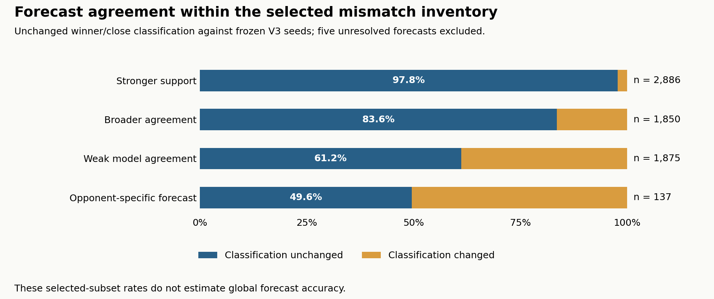

# 10,222 contexts verified; five remain unresolved

Evidence cutoff: 2026-11-06T23:29:45.366Z. This is the available-data review checkpoint for the frozen legacy/current mismatch inventory.

## Available corrections are ready for discussion

- **10,222 of 10,227 physical contexts are verified (99.95%)**, covering **18,293 of 18,298 selected displayed cells**. Five diagnosed contexts still lack complete seed/replay evidence.
- **1,164 baseline classifications changed:** 842 now have the opposite winner and 322 became mixed/close results. These changes affect 1,362 displayed alias cells. The other 9,058 reviewed contexts retained their classifications.
- All changes came from the originally forecasted group. Historical stronger-support forecasts agreed in 2,823 of 2,886 reviewed contexts (97.8%); weak-model-agreement forecasts agreed in 1,147 of 1,875 (61.2%).
- The available queue is finished and only the five blocked contexts remain. Production is unchanged. Review the data and blockers before authorizing one consolidated website release.

These are **selected mismatch results**, not an unbiased estimate of global forecast accuracy. The comparisons use the immutable original database; they include corrections published before the data-only pause and are not all additional changes versus current production.

## Historical forecast tiers separated the stronger and weaker cases



| Original tier | Reviewed contexts | Unchanged | Changed | Unresolved | Agreement in this subset |
|---|---|---|---|---|---|
| stronger_support | 2,886 | 2,823 | 63 | 2 | 97.8% |
| broader_agreement | 1,850 | 1,546 | 304 | 1 | 83.6% |
| weak_model_agreement | 1,875 | 1,147 | 728 | 2 | 61.2% |
| opponent_specific_forecast | 137 | 68 | 69 | 0 | 49.6% |


Across the 6,748 reviewed forecasts, 5,584 retained their original winner/close classification (**82.8%**). Opponent-specific forecasts had 69 changes in 137 reviewed contexts, so that small subgroup needs particular attention during review. Weak-model-agreement forecasts account for 728 of the 1,164 changes. The tier names are preserved historical categories, not calibrated probabilities or new model judgments. No forecasts were retrained or expanded.

## Original observations and inference classifications were retained

| Original evidence | Reviewed | Unchanged | Changed | Unresolved |
|---|---|---|---|---|
| identity | 7 | 7 | 0 | 0 |
| inferred | 1,004 | 1,004 | 0 | 0 |
| observed | 2,463 | 2,463 | 0 | 0 |
| predicted_unvalidated | 6,748 | 5,584 | 1,164 | 5 |


The 1,004 originally inferred contexts comprise 870 `R1_STATIC_DIRECTION`, 110 `R2_ROBUST_TRADEOFF` and 24 `R3_TWO_SIDED_STATIC` contexts; all retained their classifications in these tests. An additional 124 forecast contexts carry R1/R2 provenance and stay in the forecast group: 3 of 56 carrying R1 and 4 of 68 carrying R2 changed. They must not be relabeled as failed inferred measurements.

Verification used 7,843 complete freshly computed seed sets and 2,379 complete pre-existing native sets with a fresh exact replay. The latter verify reproducibility of prior measured evidence; they do not test forecast accuracy. All 10,222 included contexts have complete required seeds and an exact replay under the original physical context.

## Direct old/current winner conflicts favor the current label more often

The direct opposite-winner source claims resolve to **1,056 unique displayed cells**; repeated claims from overlapping sources are counted once here. Among the reviewed cells, the current classification was retained in 846, the legacy winner matched in 155, and 54 became mixed results; 1 remains unresolved. These outcomes apply to the frozen current physical scenarios and do not establish the legacy table's original battle conditions.

Deduplicating displayed aliases gives **561 physical contexts**, of which 560 have reviewed results: 396 retained the current classification, 125 matched the legacy winner, and 39 were mixed. The 396 include 156 originally observed and 47 inferred contexts, so they must not all be described as successful guesses.

For the **357 reviewed physical contexts that were forecasts and directly named the opposite winner to the legacy table**, the split is:

| Validation supports | Contexts | Share of the 357 reviewed forecast conflicts |
|---|---|---|
| Newer forecast | 193 | 54.1% |
| Legacy winner | 125 | 35.0% |
| Mixed/close outcome | 39 | 10.9% |

One further forecast conflict is simulator-blocked and excluded. Counting displayed cells instead gives 244 newer-forecast matches, 155 legacy matches and 54 mixed results (453 reviewed cells). See the [full direct-conflict list](direct-winner-conflicts.csv.gz). The rest of the 10,227-context inventory also includes mixed/close and composition-coverage differences; it is not entirely direct opposite-winner disputes or forecasts. The five user-supplied winners are recorded separately in the [user-outcome addendum](USER_OUTCOMES.md) and excluded from all simulator agreement rates.

## Mixed outcomes and low surviving HP need different interpretations

There are **412 mixed/close results**: 90 retain an original close classification and 322 replace a decisive forecast. The frozen classifier uses initial seeds 0–2 and requires seeds 3–9 if the initial winners differ. Identity equivalence remains a separate semantic classification.

Separately, **367 decisive contexts have median winning-army surviving HP at or below 10%** across their required seeds. This descriptive review aid does not change their winners, classifications or scores. The [close-or-low-survival list](close-or-low-survival-contexts.csv.gz) retains both kinds with their distinct result and HP fields.

HP is expressed relative to the recorded initial army HP. Twenty-one seed ratios in [seven Wei Elite Tiger Cavalry contexts](hp-growth-contexts.csv.gz) exceed 100% (105.0–107.5%). The frozen profile grants 10 HP and maximum HP per kill, capped at 40; these are preserved ratios, not percentages of a fixed maximum. All reported ratios were checked against the original remaining/starting HP fields, with no clamping or measurement changes.

## Five cases cannot currently become corrections

| Original physical matchup (diagnosis) | Army counts | Saved seeds | Missing required seeds |
|---|---|---|---|
| [Aztec Elite Skirmisher / Hunnic Elite Tarkan](https://github.com/ddk220-light/aoe2_matchup/blob/simulations/civ-matchups-mismatch-validation-2026-11-05/aoe2x/js_simulation/calibration/campaigns/civ-matchups-mismatch-validation-2026-11-05/diagnostics/mv_306dd795e5f68374d24e2a99/REVIEW.json) | 27/18 | 0 | 1, 2 |
| [Armenian Champion / Tupi Imperial Slinger](https://github.com/ddk220-light/aoe2_matchup/blob/simulations/civ-matchups-mismatch-validation-2026-11-05/aoe2x/js_simulation/calibration/campaigns/civ-matchups-mismatch-validation-2026-11-05/diagnostics/mv_5e1e0d268234acff1d6e9008/REVIEW.json) | 27/27 | 0 | 1, 2 |
| [Chinese Elite Chu Ko Nu / Khitan Mounted Trebuchet](https://github.com/ddk220-light/aoe2_matchup/blob/simulations/civ-matchups-mismatch-validation-2026-11-05/aoe2x/js_simulation/calibration/campaigns/civ-matchups-mismatch-validation-2026-11-05/diagnostics/mv_9bc2d959cf36c2b00f7ffa75/REVIEW.json) | 27/12 | 0, 1, 2, 3, 4, 5, 6 | 7, 8, 9 |
| [Muisca Elite Guecha Warrior / Viking Champion](https://github.com/ddk220-light/aoe2_matchup/blob/simulations/civ-matchups-mismatch-validation-2026-11-05/aoe2x/js_simulation/calibration/campaigns/civ-matchups-mismatch-validation-2026-11-05/diagnostics/mv_c72552550f46f7a6f193d254/REVIEW.json) | 22/27 | 0, 1 | 2 |
| [Lithuanian Elite Skirmisher / Gurjara Heavy Camel](https://github.com/ddk220-light/aoe2_matchup/blob/simulations/civ-matchups-mismatch-validation-2026-11-05/aoe2x/js_simulation/calibration/campaigns/civ-matchups-mismatch-validation-2026-11-05/diagnostics/mv_e50435eb3040ac8928d195ee/REVIEW.json) | 27/20 | 0 | 1, 2 |


The Armenian/Tupi and Muisca/Viking cases repeat idle patrol-endpoint states. The Aztec/Hunnic and Lithuanian/Gurjara cases retain survivors in prolonged pursuit/contact loops without further damage. The Chinese/Khitan case retains two survivors with no further damage while movement and route activity continue. Each linked diagnosis binds the original context, attempt lines and saved timelines. None establishes a real-game draw or a winner.

At least **10 required seed measurements and five pair replay reviews remain missing**. More seeds could be needed if newly completed initial seeds disagreed. Four contexts exhausted the normal watchdog schedule; the Armenian fourth attempt was deliberately canceled after its repeated diagnostic state was preserved. Blind retries, copied winners and physics changes are outside the current scope. A separately reviewed recovery decision is needed to advance them.

The campaign retains 39 watchdog attempt records across 18 contexts. Thirteen of those contexts eventually completed validly; five remain unresolved. Timeouts and diagnostic snapshots contribute no outcomes.

## Full data and reproducibility

- [Cumulative correction snapshot](https://github.com/ddk220-light/aoe2_matchup/blob/simulations/civ-matchups-mismatch-validation-2026-11-05/aoe2x/js_simulation/calibration/campaigns/civ-matchups-mismatch-validation-2026-11-05/correction-snapshots/review-ready-2026-11-07/manifest.json): full native records, original evidence/flags, exact replay references and original physical contexts. Its `complete` field is **false**, with five contexts excluded.
- [Full frozen displayed mismatch list](https://github.com/ddk220-light/aoe2_matchup/blob/simulations/civ-matchups-mismatch-validation-2026-11-05/aoe2x/js_simulation/calibration/campaigns/civ-matchups-mismatch-validation-2026-11-05/mismatches.jsonl.gz) and [full physical-context inventory](https://github.com/ddk220-light/aoe2_matchup/blob/simulations/civ-matchups-mismatch-validation-2026-11-05/aoe2x/js_simulation/calibration/campaigns/civ-matchups-mismatch-validation-2026-11-05/jobs.jsonl.gz).
- [All context analysis rows](context-analysis.csv.gz), [all displayed-cell rows](display-cell-analysis.csv.gz), and [all 1,164 changed contexts](changed-contexts.csv).
- [Exact analytical counts and definitions](analysis.json), [reproducible analysis script](build_analysis.py), and [verification receipt](verification.json).
- [Frozen campaign manifest](https://github.com/ddk220-light/aoe2_matchup/blob/simulations/civ-matchups-mismatch-validation-2026-11-05/aoe2x/js_simulation/calibration/campaigns/civ-matchups-mismatch-validation-2026-11-05/manifest.json), [source checkpoint](https://github.com/ddk220-light/aoe2_matchup/commit/e6b6326de5675b4a804b906e30fa98c755584e74), and [retained export-buffer regression check](https://github.com/ddk220-light/aoe2_matchup/blob/simulations/civ-matchups-mismatch-validation-2026-11-05/aoe2x/js_simulation/calibration/campaigns/civ-matchups-mismatch-validation-2026-11-05/exporter-checks/large-review-list-2026-11-06.json).

The source audit reconciles all 80 phase reviews (75 passed and five with blocked contexts), 28,195 unique campaign journal records, all 62 frozen runtime files and 62 frozen input files, and zero display-orientation mismatches. Every original evidence object is retained unchanged in the snapshot, including prediction policy `prediction-first-pass-v2`, per-row rule/source hashes, `sourceContext`, flags and prior validation status. Display aliases are mapped through their frozen validation job; a physical winner is never transferred into a reversed context.

Reproduce the tables and chart from the repository root, choosing a new output directory:

```sh
python aoe2x/js_simulation/calibration/reports/civ-mismatch-review-ready-2026-11-07/build_analysis.py --output /tmp/aoe2-mismatch-review-reproduction
```

The complete seed/replay checks and these analytical summaries establish provenance and reproducibility **inside frozen V3**. They are not independent in-game fidelity validation. The separate YouTube recording indexes discussed earlier have not been imported or mixed into these native records.

## Release hold

The serving database remains at SHA-256 `2ea93603cf9b4e69ee6572c36938a0e49c63bca7a6384c0a2409d7d762325c1e`. The immutable comparison baseline is `93e5732f5e1afd08a9be5b292506edb2f4ee41c2be4352a8bc4128184a05ebb8`. Website main/staging remain at `2315f74ad12d57bb2af73d47c622eb0c7d06c3b2`.

No serving-data import, website rebuild/export, release CI/preview, staging/main push or production deployment is part of this checkpoint. Keep the monitor paused for analysis and discussion. One consolidated release still requires the user's explicit approval and the saved release gates; preserve all unresolved cases and historical evidence.
